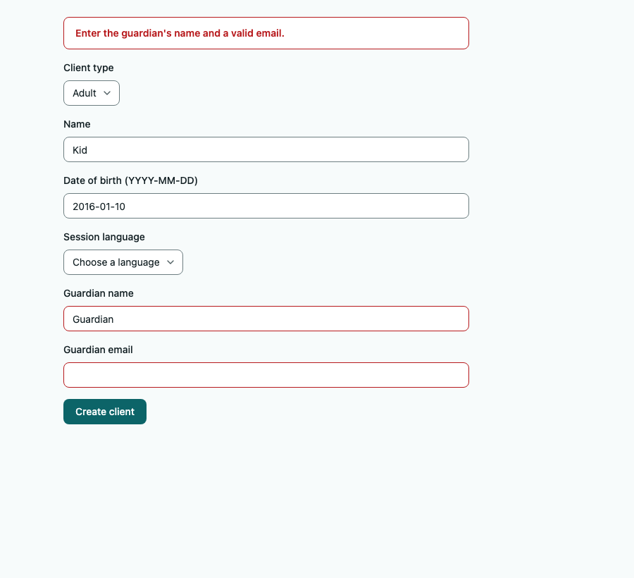
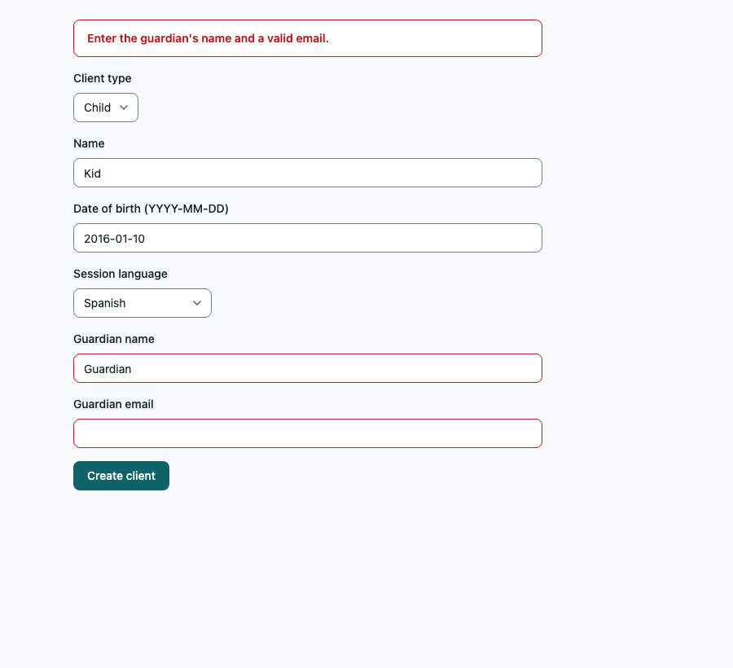

# Цикл візуальної перевірки в браузері (бонус WS7)

**Що перевіряли:** форма нової картки клієнта (`src/app/clients/_components/client-card-form.tsx`) після відмови сервера: AC-CARD-03
каже, що введені дані лишаються у формі.

**Хід циклу** (агент у справжньому браузері, не лише модульні тести):
1. Сліпий рецензент коректності зібрав форму з підміненою дією (вона повертає відмову «INVALID_GUARDIAN») і відкрив її в headless Chrome
   (React 19.3, як у застосунку): вибрав «Child», мову «Spanish», лишив email опікуна порожнім, натиснув Create client.
2. **Знайдено:** після відмови React 19 скидає форму, і значення селектів губляться: тип показує «Adult» (поля опікуна лишились
   на екрані, бо стан `type` не змінився), мова — «Choose a language». Модульний тест на статичній розмітці (`renderToStaticMarkup`)
   цього не бачив: у ньому `defaultValue` застосовується, а скидання форми — ні.
3. **Виправлено:** поля монтуються наново з результатом дії (`key` від коду й повернутих значень).
4. **Повторна перевірка** тим самим сценарієм у браузері — і на проді (див. `docs/evidence/slice2-prod-roles.md`: «Child» і ім'я лишились,
   поля опікуна позначено).

**Знімки до й після** (один і той самий сценарій, ті самі дані; «до» — та сама форма без `key`):

| До виправлення | Після виправлення |
|---|---|
|  |  |

До: тип «Adult», мова «Choose a language», але поля опікуна ще на екрані. Після: «Child», «Spanish», ім'я й дата лишились,
повідомлення PM над формою, поля опікуна позначено.

**Що пропустили:** стани завантаження (кнопка вимикається на час запиту, але знімка немає), мобільна ширина, перемикач типу після
відмови без JavaScript (форма працює без нього, але ця гілка не перевірялась у браузері).

**Промпт рецензенту** (скорочено): «Ти — незалежний рецензент коректності: прочитай форму картки, знайди, чи губляться введені значення
після відмови сервера, і відтвори це в справжньому браузері, не лише в тесті». Без підказки, де саме ризик.
