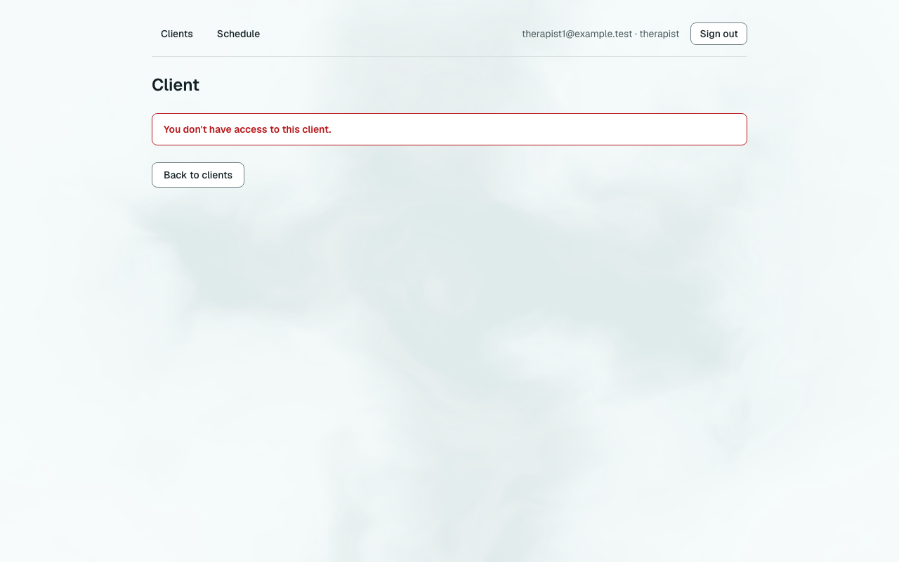
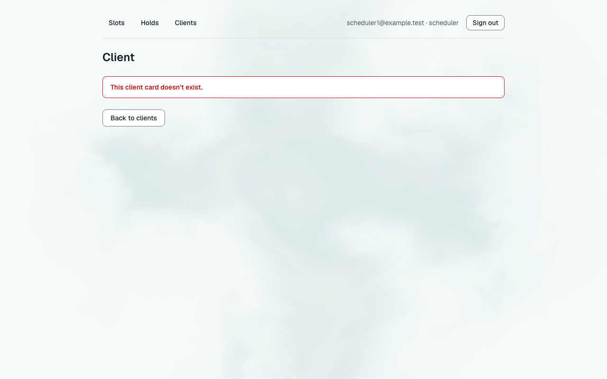
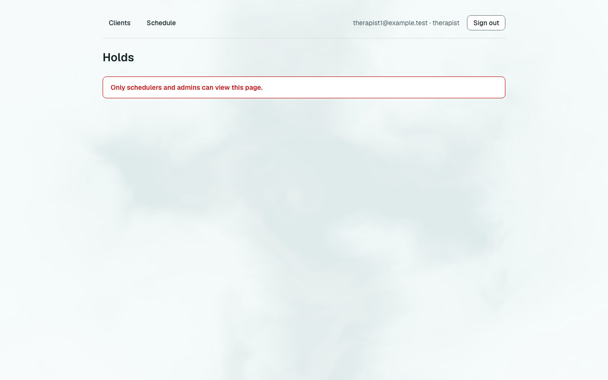

# Звіт UAT — 03.11.2026

- **Застосунок:** https://therapy-scheduling-weld.vercel.app (/api/health: коміт `12a33a7`)
- **Код тестів:** `task/uat` @ `12a33a7` + незакомічені зміни
- **Прогін:** 03.11.2026, 21:49 (Київ), Playwright 44.4 с; AC: 3 — PASS 3, FAIL 0, NEEDS-HUMAN 0
- **Рецензент:** `claude-haiku-5-5`; суперечки → `claude-sonnet-5-5`. Разом за розбір: $0.0066 (ціни API; за підпискою — у межах ліміту плану)
- **Відео й траси:** не в git — `test-results/` локально або артефакт CI; трасу відкриває `npx playwright show-trace <trace.zip>`

| AC | Перевірки | Агент | Підсумок | Чому | Playwright | Розбір |
|---|---|---|---|---|---|---|
| AC-CARD-05 | пройшли | Haiku: PASS | **PASS** | R6: перевірки, агент і цитати збігаються | 9.8 с | $0.0020, 7.5 с |
| AC-CARD-16 | пройшли | Haiku: PASS | **PASS** | R6: перевірки, агент і цитати збігаються | 6.6 с | $0.0023, 9.3 с |
| AC-HOLD-44 | пройшли | Haiku: PASS | **PASS** | R6: перевірки, агент і цитати збігаються | 10.2 с | $0.0024, 9.1 с |

## AC-CARD-05 — PASS

**Тест:** AC-CARD-05: терапевт відкриває за прямим посиланням картку клієнта іншого терапевта — повідомлення «You don't have access to this client.», даних клієнта немає, картка не змінилась

**Критерій** (requirements/19-planuvalnyk-zapovniuie-kartku-klienta.md):

> AC-CARD-05: Дано client9 — свій клієнт лише для therapist2. Коли therapist1 відкриває картку client9 за прямим посиланням. Тоді therapist1 бачить повідомлення «You don't have access to this client.», жодних даних client9 не показано, і картка client9 не змінилася.

**Кроки:** ✔ Дано: клієнт — «свій клієнт» лише для одного терапевта: є в його списку клієнтів і немає в списку іншого → ✔ Коли: інший терапевт відкриває картку цього клієнта за прямим посиланням → ✔ Тоді: бачить повідомлення «You don't have access to this client.», жодних даних клієнта не показано, і картка клієнта не змінилася

**Агент (claude-haiku-5-5, PASS):** На кадрі видно сторінку «Client» із червоною плашкою «You don't have access to this client.», кнопкою «Back to clients» і шапкою therapist1@example.test. Жодного імені, email чи дат клієнта на сторінці немає. Апостроф у повідомленні виглядає як прямий (') і збігається з критерієм, хоча при такій роздільній здатності відрізнити його від типографського (’) повністю не можна.

**Цитати агента, звірені зі сторінкою (aria):**
- «You don't have access to this client.» — є на сторінці

**Правило:** R6: перевірки, агент і цитати збігаються

**Відео:** `test-results/artifacts/client-card-AC-CARD-05-AC--c46a0-а-немає-картка-не-змінилась-chromium/video.webm` · **траса:** `test-results/artifacts/client-card-AC-CARD-05-AC--c46a0-а-немає-картка-не-змінилась-chromium/trace.zip` (не в git)

**Рішення PM:** ☐ приймаю · ☐ відхилення від вимог (issue «Відхилення від вимог: AC-CARD-05 — …») · @login: ____

## AC-CARD-16 — PASS

**Тест:** AC-CARD-16: картки, на яку веде посилання, не існує — scheduler бачить «This client card doesn't exist.», therapist — «You don't have access to this client.», даних клієнтів немає

**Критерій** (requirements/19-planuvalnyk-zapovniuie-kartku-klienta.md):

> AC-CARD-16: Дано картки клієнта, на яку веде посилання, не існує. Коли scheduler1, а потім therapist1 відкриває це посилання. Тоді scheduler1 бачить повідомлення «This client card doesn't exist.», therapist1 — «You don't have access to this client.», і жоден із них не бачить жодних даних клієнтів.

**Кроки:** ✔ Дано: картки клієнта, на яку веде посилання, не існує → ✔ Коли: scheduler1 відкриває це посилання → ✔ Тоді: scheduler1 бачить повідомлення «This client card doesn't exist.», і жодних даних клієнтів не бачить → ✔ Коли: а потім therapist1 відкриває це саме посилання → ✔ Тоді: therapist1 бачить повідомлення «You don't have access to this client.», і жодних даних клієнтів не бачить

**Агент (claude-haiku-5-5, PASS):** На кадрі frame-then-1.png для scheduler1 видно червоний блок з текстом «This client card doesn't exist.» і заголовок «Client». На frame-then-2.png для therapist1 видно такий самий блок з текстом «You don't have access to this client.». На обох кадрах немає карток клієнтів чи email, але цю частину перевіряють автоматичні перевірки. Апостроф на кадрах виглядає як прямий, як у критерії; з тією ж точністю його можна звірити лише за оригіналом.

**Цитати агента, звірені зі сторінкою (aria):**
- «This client card doesn't exist.» — є на сторінці
- «You don't have access to this client.» — є на сторінці

**Правило:** R6: перевірки, агент і цитати збігаються

**Відео:** `test-results/artifacts/client-card-AC-CARD-16-AC--81867-ient-»-даних-клієнтів-немає-chromium/video.webm` · **траса:** `test-results/artifacts/client-card-AC-CARD-16-AC--81867-ient-»-даних-клієнтів-немає-chromium/trace.zip` (не в git)

**Рішення PM:** ☐ приймаю · ☐ відхилення від вимог (issue «Відхилення від вимог: AC-CARD-16 — …») · @login: ____

## AC-HOLD-44 — PASS

**Тест:** AC-HOLD-44: терапевт відкриває за прямим посиланням список утримань планувальника, а потім слоти іншого терапевта — повідомлення «Only schedulers and admins can view this page.», без утримань і даних клієнтів

**Критерій** (requirements/2-planuvalnyk-utrymuie-slot-terapevta.md):

> AC-HOLD-44: Дано therapist1 увійшов у застосунок. Коли він відкриває за прямим посиланням список утримань планувальника, а потім слоти therapist2 на 2026-11-03. Тоді в обох випадках він бачить повідомлення «Only schedulers and admins can view this page.», жодних утримань, імен чи email клієнтів не показано, і жодне утримання не змінилося.

**Кроки:** ✔ Дано: therapist1 увійшов у застосунок; утримання й слоти therapist2 видно планувальнику → ✔ Коли: він відкриває за прямим посиланням список утримань планувальника → ✔ Тоді: бачить повідомлення «Only schedulers and admins can view this page.», жодних утримань, імен чи email клієнтів не показано → ✔ Коли: а потім відкриває слоти therapist2 на 2026-11-03 → ✔ Тоді: в обох випадках він бачить повідомлення «Only schedulers and admins can view this page.», жодних утримань, імен чи email клієнтів не показано, і жодне утримання не змінилося

**Агент (claude-haiku-5-5, PASS):** На обох кадрах (/holds і /slots) видно однаковий червоний напис «Only schedulers and admins can view this page.» і заголовок сторінки без жодного списку, таблиці чи даних клієнтів. Email у шапці — therapist1@example.test, це email самого користувача, а не клієнта. Частини про відсутність утримань і незмінність даних не з кадрів, тому не оцінювалися.

**Цитати агента, звірені зі сторінкою (aria):**
- «Only schedulers and admins can view this page.» — є на сторінці
- «Only schedulers and admins can view this page.» — є на сторінці

**Правило:** R6: перевірки, агент і цитати збігаються

**Відео:** `test-results/artifacts/slots-holds-AC-HOLD-44-тер-61e7f-з-утримань-і-даних-клієнтів-chromium/video.webm` · **траса:** `test-results/artifacts/slots-holds-AC-HOLD-44-тер-61e7f-з-утримань-і-даних-клієнтів-chromium/trace.zip` (не в git)

**Рішення PM:** ☐ приймаю · ☐ відхилення від вимог (issue «Відхилення від вимог: AC-HOLD-44 — …») · @login: ____

## Як читати підсумок

- **PASS** — автоматичні перевірки пройшли, агент-рецензент погодився з кадром, а кожну його цитату знайдено на сторінці.
- **FAIL** — впала автоматична перевірка. Агент цього не перекриває: невидимі вади (буфер обміну, база) він на кадрі не побачить.
- **NEEDS-HUMAN** — перевірки зелені, але агент не погодився або його цитати немає на сторінці. Часто це слабкий тест або розбіжність між текстом AC і тестом — питання до PM, а не обов'язково вада продукту.

Правила: R1: перевірка впала — FAIL завжди, агент не перекриває; R2: немає вердикту агента або кадру; R3: перевірки пройшли, агент не погоджується — вирішує людина; R4: цитати агента немає на сторінці (aria) — не підтверджено; R5: помилка сторінки або 5xx під час сценарію; R6: перевірки, агент і цитати збігаються.
