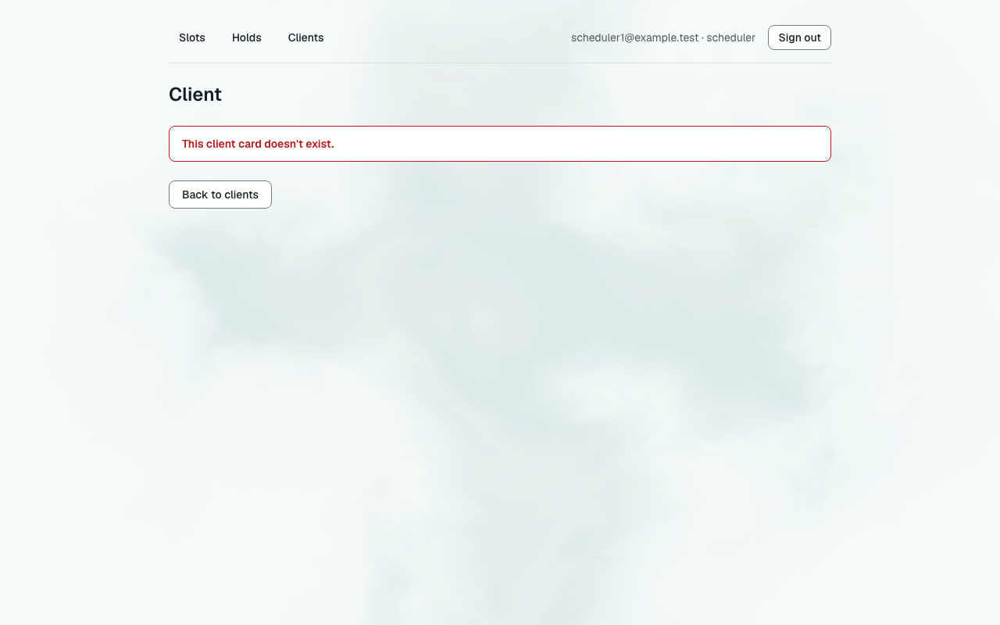
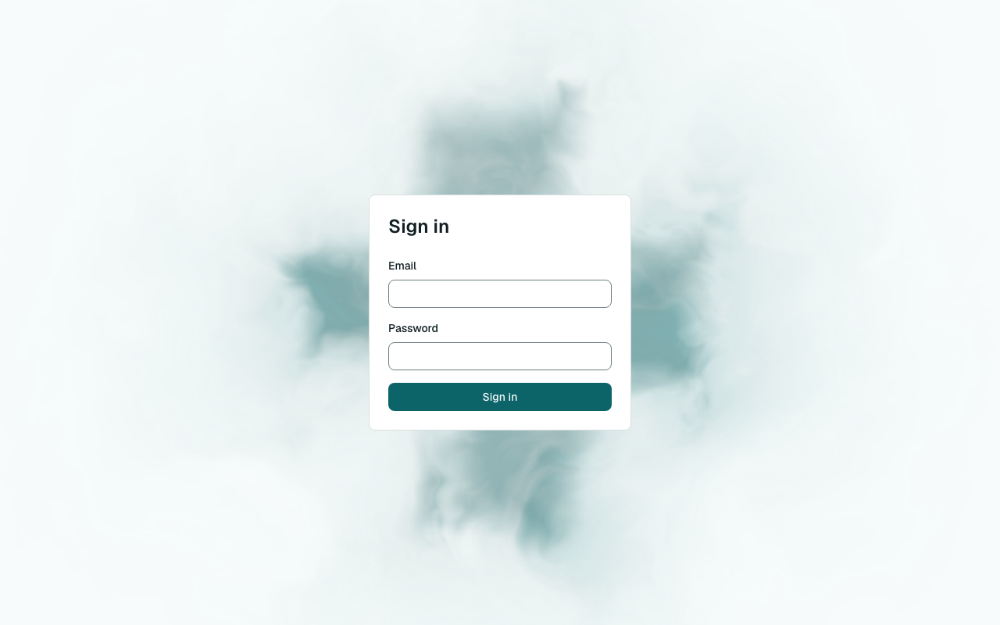

# Звіт UAT — 08.11.2026

- **Застосунок:** https://therapy-scheduling-weld.vercel.app (/api/health: коміт `7c6adb8`)
- **Код тестів:** `docs/ws9-proof-pack` @ `a2953b5`
- **Прогін:** 08.11.2026, 10:04 (Київ), Playwright 156.9 с; AC: 0 — PASS 0, FAIL 0, NEEDS-HUMAN 0; негативних контролів: 3
- **Рецензент:** `claude-haiku-5-5`; суперечки → `claude-sonnet-5-5`. Разом за розбір: $0.0000 (ціни API; за підпискою — у межах ліміту плану)
- **Відео й траси:** не в git і не в CI — лише `test-results/` на машині прогону; трасу відкриває `npx playwright show-trace <trace.zip>`

| AC | Перевірки | Агент | Підсумок | Чому | Playwright | Розбір |
|---|---|---|---|---|---|---|
| NC-1 (AC-CARD-16) | впали | — | **FAIL** | R1: перевірка впала — FAIL завжди, агент не перекриває | 67.8 с | $0.0000, 2.3 с |
| NC-2 (AC-CARD-16) | впали | — | **FAIL** | R1: перевірка впала — FAIL завжди, агент не перекриває | 63.1 с | $0.0000, 2.2 с |
| NC-3 (AC-INS-06) | впали | — | **FAIL** | R1: перевірка впала — FAIL завжди, агент не перекриває | 6.9 с | $0.0000, 2.3 с |

## NC-1 — негативний контроль для AC-CARD-16 — FAIL

**Тест:** NC-1 (AC-CARD-16, навмисно хибне очікування в тесті: інший текст повідомлення)

**Критерій** (requirements/19-planuvalnyk-zapovniuie-kartku-klienta.md):

> AC-CARD-16: Дано картки клієнта, на яку веде посилання, не існує. Коли scheduler1, а потім therapist1 відкриває це посилання. Тоді scheduler1 бачить повідомлення «This client card doesn't exist.», therapist1 — «You don't have access to this client.», і жоден із них не бачить жодних даних клієнтів.



**Кроки:** ✔ Дано: scheduler1 увійшов у застосунок → ✔ Коли: scheduler1 відкриває посилання на картку, якої не існує → ✘ Тоді: scheduler1 бачить повідомлення «This client card doesn't exist.», і жодних даних клієнтів не бачить

**Перевірка впала:**

```
Error: expect(locator).toHaveText(expected) failed

Locator:  locator('main').getByRole('alert')
Expected: "This client card does not exist."
Received: "This client card doesn't exist."
Timeout:  5000ms

Call log:
```

**Агент:** вердикту немає

**Правило:** R1: перевірка впала — FAIL завжди, агент не перекриває

**Відео:** `—` · **траса:** `test-results/artifacts/negative-controls-NC-1-AC--6ed84-і-інший-текст-повідомлення--negative-controls/trace.zip` (не в git)

_Негативний контроль: навмисно хибне очікування. Очікуваний підсумок — FAIL або NEEDS-HUMAN, не PASS._

## NC-2 — негативний контроль для AC-CARD-16 — FAIL

**Тест:** NC-2 (AC-CARD-16, текст «Тоді» у вимозі уточнено, тест і застосунок — ні)

**Критерій** (анотація ac-text у тесті (негативний контроль)):

> AC-CARD-16: Дано картки клієнта, на яку веде посилання, не існує. Коли scheduler1 відкриває це посилання. Тоді scheduler1 бачить повідомлення «This client card was not found.», і жодних даних клієнтів не бачить.


**Кроки:** ✔ Дано: scheduler1 увійшов у застосунок → ✔ Коли: scheduler1 відкриває посилання на картку, якої не існує → ✔ Тоді: scheduler1 бачить повідомлення «This client card doesn't exist.», і жодних даних клієнтів не бачить

**Перевірка впала:**

```
Test timeout of 60000ms exceeded while running "afterEach" hook.
```

**Агент:** вердикту немає

**Правило:** R1: перевірка впала — FAIL завжди, агент не перекриває

**Відео:** `—` · **траса:** `test-results/artifacts/negative-controls-NC-2-AC--0d758-ено-тест-і-застосунок-—-ні--negative-controls/trace.zip` (не в git)

_Негативний контроль: навмисно хибне очікування. Очікуваний підсумок — FAIL або NEEDS-HUMAN, не PASS._

## NC-3 — негативний контроль для AC-INS-06 — FAIL

**Тест:** NC-3 (AC-INS-06, навмисно хибне очікування в тесті: інша назва кнопки на сторінці входу)

**Критерій** (requirements/33-planuvalnyk-poznachaie-status-perevirky.md):

> AC-INS-06: Дано користувач не увійшов у застосунок, а картка client6 показує «Insurance: Verified». Коли він відкриває картку client6 за прямим посиланням. Тоді він бачить лише сторінку входу, статусу страхування й інших даних client6 не показано, а scheduler1 після цього бачить у картці client6 «Insurance: Verified».



**Кроки:** ✔ Дано: користувач не увійшов у застосунок → ✔ Коли: він відкриває картку клієнта за прямим посиланням → ✘ Тоді: він бачить лише сторінку входу, статусу страхування й інших даних клієнта не показано

**Перевірка впала:**

```
Error: expect(locator).toBeVisible() failed

Locator: getByRole('button', { name: 'Log in' })
Expected: visible
Timeout: 5000ms
Error: element(s) not found

Call log:
```

**Агент:** вердикту немає

**Правило:** R1: перевірка впала — FAIL завжди, агент не перекриває

**Відео:** `test-results/artifacts/negative-controls-NC-3-NC--a35d6-а-кнопки-на-сторінці-входу--negative-controls/video.webm` · **траса:** `test-results/artifacts/negative-controls-NC-3-NC--a35d6-а-кнопки-на-сторінці-входу--negative-controls/trace.zip` (не в git)

_Негативний контроль: навмисно хибне очікування. Очікуваний підсумок — FAIL або NEEDS-HUMAN, не PASS._

## Як читати підсумок

- **PASS** — автоматичні перевірки пройшли, агент-рецензент погодився з кадром, а кожну його цитату знайдено на сторінці.
- **FAIL** — впала автоматична перевірка. Агент цього не перекриває: невидимі вади (буфер обміну, база) він на кадрі не побачить.
- **NEEDS-HUMAN** — перевірки зелені, але агент не погодився або його цитати немає на сторінці. Часто це слабкий тест або розбіжність між текстом AC і тестом — питання до PM, а не обов'язково вада продукту.

Правила: R1: перевірка впала — FAIL завжди, агент не перекриває; R2: немає вердикту агента (або він про інший AC) чи кадру; R3: перевірки пройшли, агент не погоджується — вирішує людина; R4: не всі видимі частини підтверджено або цитат агента немає на сторінці (aria); R5: помилка сторінки або 5xx під час сценарію; R6: перевірки, агент і цитати збігаються.
