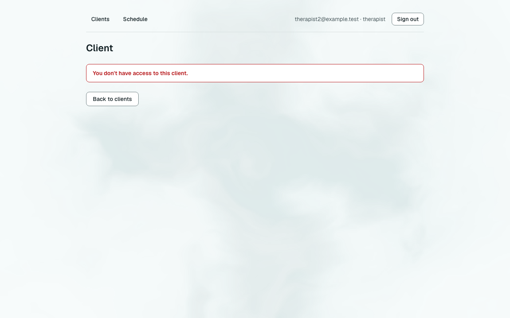
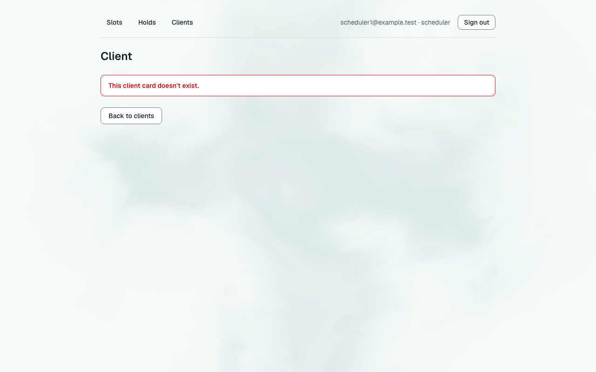
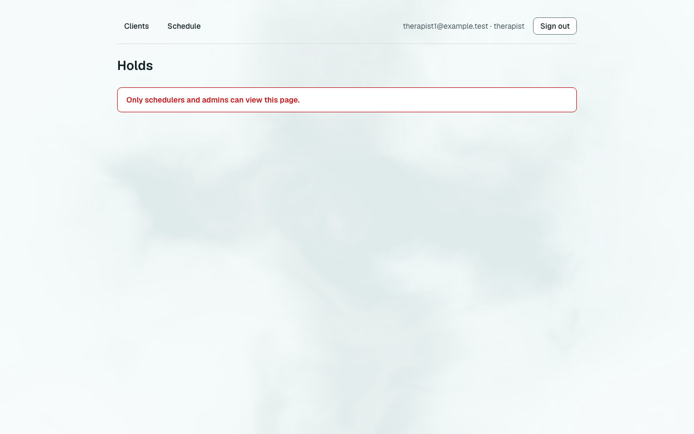
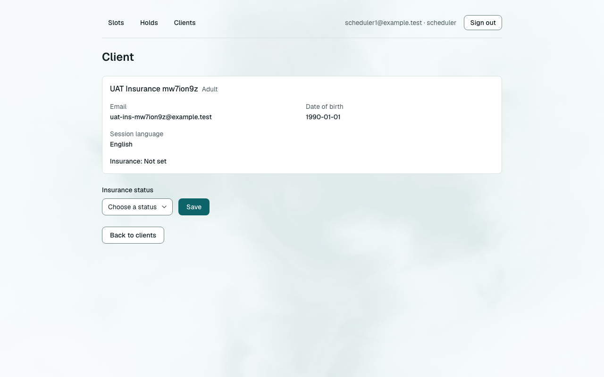
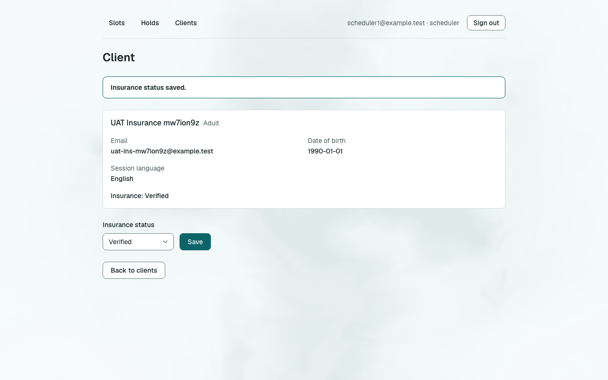
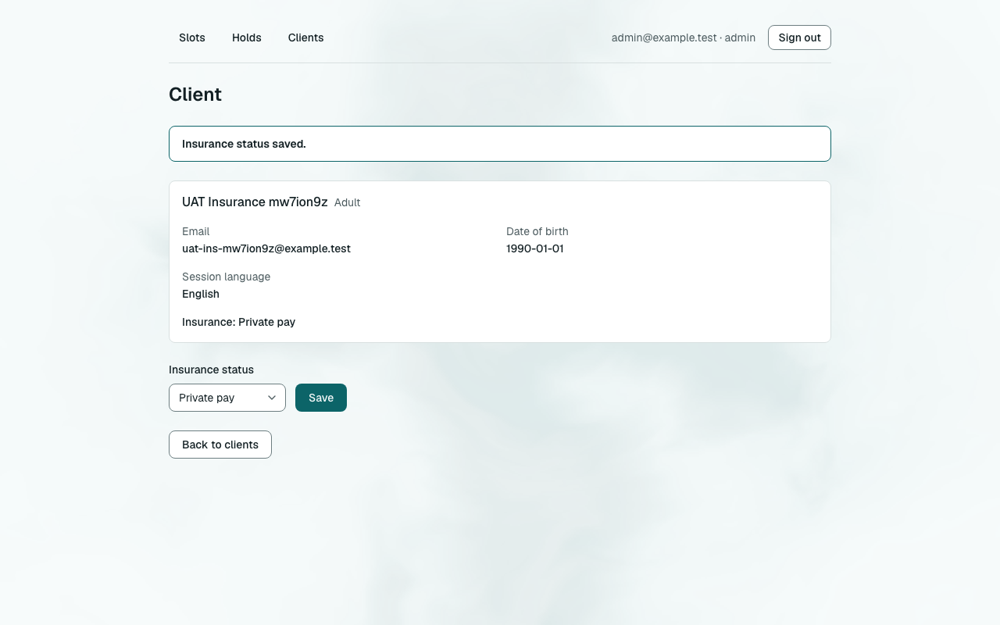
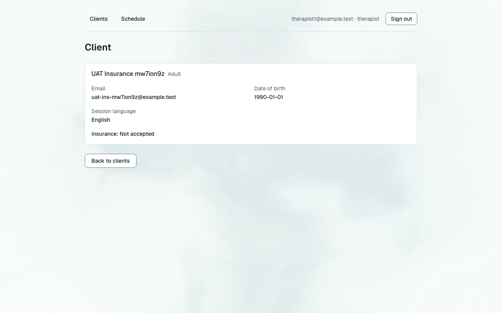
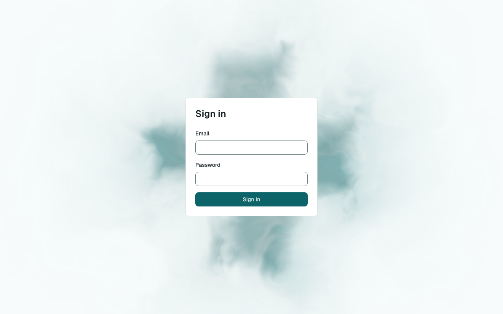

# Звіт UAT — 08.11.2026

- **Застосунок:** https://therapy-scheduling-weld.vercel.app (/api/health: коміт `34a9c7d`)
- **Код тестів:** `task/insurance-status-uat-prod` @ `34a9c7d`
- **Прогін:** 08.11.2026, 09:34 (Київ), Playwright 88.8 с; AC: 9 — PASS 8, FAIL 0, NEEDS-HUMAN 1
- **Рецензент:** `claude-haiku-5-5`; суперечки → `claude-sonnet-5-5`. Разом за розбір: $0.0534 (ціни API; за підпискою — у межах ліміту плану)
- **Відео й траси:** не в git і не в CI — лише `test-results/` на машині прогону; трасу відкриває `npx playwright show-trace <trace.zip>`

| AC | Перевірки | Агент | Підсумок | Чому | Playwright | Розбір |
|---|---|---|---|---|---|---|
| AC-CARD-05 | пройшли | Haiku: NEEDS-HUMAN, Sonnet: NEEDS-HUMAN | **NEEDS-HUMAN** | R3: перевірки пройшли, агент не погоджується — вирішує людина | 8.3 с | $0.0367, 22.4 с |
| AC-CARD-16 | пройшли | Haiku: PASS | **PASS** | R6: перевірки, агент і цитати збігаються | 5.3 с | $0.0023, 7.7 с |
| AC-HOLD-44 | пройшли | Haiku: PASS | **PASS** | R6: перевірки, агент і цитати збігаються | 9.2 с | $0.0027, 9.5 с |
| AC-INS-01 | пройшли | Haiku: PASS | **PASS** | R6: перевірки, агент і цитати збігаються | 9.2 с | $0.0018, 5.8 с |
| AC-INS-02 | пройшли | Haiku: PASS | **PASS** | R6: перевірки, агент і цитати збігаються | 6.0 с | $0.0024, 7.1 с |
| AC-INS-03 | пройшли | Haiku: PASS | **PASS** | R6: перевірки, агент і цитати збігаються | 5.8 с | $0.0019, 6.1 с |
| AC-INS-04 | пройшли | Haiku: PASS | **PASS** | R6: перевірки, агент і цитати збігаються | 11.8 с | $0.0018, 6.0 с |
| AC-INS-05 | пройшли | Haiku: PASS | **PASS** | R6: перевірки, агент і цитати збігаються | 3.2 с | $0.0019, 6.4 с |
| AC-INS-06 | пройшли | Haiku: PASS | **PASS** | R6: перевірки, агент і цитати збігаються | 8.4 с | $0.0020, 7.0 с |

## AC-CARD-05 — NEEDS-HUMAN

**Тест:** AC-CARD-05: терапевт відкриває за прямим посиланням картку клієнта іншого терапевта — повідомлення «You don't have access to this client.», даних клієнта немає, картка не змінилась

**Критерій** (requirements/19-planuvalnyk-zapovniuie-kartku-klienta.md):

> AC-CARD-05: Дано client9 — свій клієнт лише для therapist2. Коли therapist1 відкриває картку client9 за прямим посиланням. Тоді therapist1 бачить повідомлення «You don't have access to this client.», жодних даних client9 не показано, і картка client9 не змінилася.

**Кроки:** ✔ Дано: клієнт — «свій клієнт» лише для одного терапевта: є в його списку клієнтів і немає в списку іншого → ✔ Коли: інший терапевт відкриває картку цього клієнта за прямим посиланням → ✔ Тоді: бачить повідомлення «You don't have access to this client.», жодних даних клієнта не показано, і картка клієнта не змінилася

**Агент (claude-sonnet-5-5, NEEDS-HUMAN):** На кадрі є червоне повідомлення «You don't have access to this client.» і кнопка «Back to clients»; даних клієнта не видно. У шапці вказано therapist2@example.test, а не therapist1, тому відповідність сценарію потрібно перевірити людині.

Haiku сказав NEEDS-HUMAN, тож розбір повторив Sonnet; рішення агента — за Sonnet.

**Агент бачить вади:**
- У шапці кадру видно користувача therapist2@example.test · therapist, а критерій вимагає, щоб картку відкривав therapist1. За критерієм client9 — клієнт therapist2, тож власнику не мало б показувати відмову. Кадр не підтверджує, що сценарій виконано від імені therapist1.

**Цитати агента, звірені зі сторінкою (aria):**
- «You don't have access to this client.» — є на сторінці

**Правило:** R3: перевірки пройшли, агент не погоджується — вирішує людина

**Відео:** `test-results/artifacts/client-card-AC-CARD-05-AC--c46a0-а-немає-картка-не-змінилась-chromium/video.webm` · **траса:** `test-results/artifacts/client-card-AC-CARD-05-AC--c46a0-а-немає-картка-не-змінилась-chromium/trace.zip` (не в git)

**Рішення PM:** ☐ приймаю · ☐ відхилення від вимог (issue «Відхилення від вимог: AC-CARD-05 — …») · @login: ____

## AC-CARD-16 — PASS

**Тест:** AC-CARD-16: картки, на яку веде посилання, не існує — scheduler бачить «This client card doesn't exist.», therapist — «You don't have access to this client.», даних клієнтів немає

**Критерій** (requirements/19-planuvalnyk-zapovniuie-kartku-klienta.md):

> AC-CARD-16: Дано картки клієнта, на яку веде посилання, не існує. Коли scheduler1, а потім therapist1 відкриває це посилання. Тоді scheduler1 бачить повідомлення «This client card doesn't exist.», therapist1 — «You don't have access to this client.», і жоден із них не бачить жодних даних клієнтів.

**Кроки:** ✔ Дано: картки клієнта, на яку веде посилання, не існує → ✔ Коли: scheduler1 відкриває це посилання → ✔ Тоді: scheduler1 бачить повідомлення «This client card doesn't exist.», і жодних даних клієнтів не бачить → ✔ Коли: а потім therapist1 відкриває це саме посилання → ✔ Тоді: therapist1 бачить повідомлення «You don't have access to this client.», і жодних даних клієнтів не бачить

**Агент (claude-haiku-5-5, PASS):** На frame-then-1.png (scheduler1, шапка «scheduler1@example.test · scheduler») червоним у рамці написано «This client card doesn't exist.». На frame-then-2.png (therapist1, шапка «therapist1@example.test · therapist») написано «You don't have access to this client.». Обидві частини підтверджено посимвольно; відсутність даних клієнтів на кадрах не оцінювалась, бо це «Не з кадрів».

**Цитати агента, звірені зі сторінкою (aria):**
- «This client card doesn't exist.» — є на сторінці
- «You don't have access to this client.» — є на сторінці

**Правило:** R6: перевірки, агент і цитати збігаються

**Відео:** `test-results/artifacts/client-card-AC-CARD-16-AC--81867-ient-»-даних-клієнтів-немає-chromium/video.webm` · **траса:** `test-results/artifacts/client-card-AC-CARD-16-AC--81867-ient-»-даних-клієнтів-немає-chromium/trace.zip` (не в git)

**Рішення PM:** ☐ приймаю · ☐ відхилення від вимог (issue «Відхилення від вимог: AC-CARD-16 — …») · @login: ____

## AC-HOLD-44 — PASS

**Тест:** AC-HOLD-44: терапевт відкриває за прямим посиланням список утримань планувальника, а потім слоти іншого терапевта — повідомлення «Only schedulers and admins can view this page.», без утримань і даних клієнтів

**Критерій** (requirements/2-planuvalnyk-utrymuie-slot-terapevta.md):

> AC-HOLD-44: Дано therapist1 увійшов у застосунок. Коли він відкриває за прямим посиланням список утримань планувальника, а потім слоти therapist2 на 2026-11-03. Тоді в обох випадках він бачить повідомлення «Only schedulers and admins can view this page.», жодних утримань, імен чи email клієнтів не показано, і жодне утримання не змінилося.

**Кроки:** ✔ Дано: therapist1 увійшов у застосунок; утримання й слоти therapist2 видно планувальнику → ✔ Коли: він відкриває за прямим посиланням список утримань планувальника → ✔ Тоді: бачить повідомлення «Only schedulers and admins can view this page.», жодних утримань, імен чи email клієнтів не показано → ✔ Коли: а потім відкриває слоти therapist2 на 2026-11-03 → ✔ Тоді: в обох випадках він бачить повідомлення «Only schedulers and admins can view this page.», жодних утримань, імен чи email клієнтів не показано, і жодне утримання не змінилося

**Агент (claude-haiku-5-5, PASS):** На обох кадрах (/holds і /slots) видно червоний напис «Only schedulers and admins can view this page.», який збігається з критерієм посимвольно. Сторінки порожні: списку утримань, імен чи email клієнтів на кадрах немає. Частини про відсутність даних і незмінність утримань перевіряються автоматично, тож їх не оцінював.

**Цитати агента, звірені зі сторінкою (aria):**
- «Only schedulers and admins can view this page.» — є на сторінці
- «Only schedulers and admins can view this page.» — є на сторінці

**Правило:** R6: перевірки, агент і цитати збігаються

**Відео:** `test-results/artifacts/slots-holds-AC-HOLD-44-тер-61e7f-з-утримань-і-даних-клієнтів-chromium/video.webm` · **траса:** `test-results/artifacts/slots-holds-AC-HOLD-44-тер-61e7f-з-утримань-і-даних-клієнтів-chromium/trace.zip` (не в git)

**Рішення PM:** ☐ приймаю · ☐ відхилення від вимог (issue «Відхилення від вимог: AC-HOLD-44 — …») · @login: ____

## AC-INS-01 — PASS

**Тест:** AC-INS-01: картку створено, і статус перевірки страхування ще ніхто не позначав — scheduler1 відкриває картку, в картці показано «Insurance: Not set»

**Критерій** (requirements/33-planuvalnyk-poznachaie-status-perevirky.md):

> AC-INS-01: Дано картку client6 створено, і статус перевірки страхування ще ніхто не позначав. Коли scheduler1 відкриває картку client6. Тоді в картці показано «Insurance: Not set».

**Кроки:** ✔ Дано: картку клієнта створено, і статус перевірки страхування ще ніхто не позначав → ✔ Коли: scheduler1 відкриває картку клієнта → ✔ Тоді: в картці показано «Insurance: Not set»

**Агент (claude-haiku-5-5, PASS):** На кадрі видно сторінку клієнта «UAT Insurance mw7ion9z» з рядком «Insurance: Not set» під полем «Session language». Текст збігається з критерієм посимвольно. Кадр повний, без завантаження й обрізання.

**Цитати агента, звірені зі сторінкою (aria):**
- «Insurance: Not set» — є на сторінці

**Правило:** R6: перевірки, агент і цитати збігаються

**Відео:** `test-results/artifacts/insurance-status-scheduler-a02ec-оказано-«Insurance-Not-set»-chromium/video.webm` · **траса:** `test-results/artifacts/insurance-status-scheduler-a02ec-оказано-«Insurance-Not-set»-chromium/trace.zip` (не в git)

**Рішення PM:** ☐ приймаю · ☐ відхилення від вимог (issue «Відхилення від вимог: AC-INS-01 — …») · @login: ____

## AC-INS-02 — PASS

**Тест:** AC-INS-02: картка показує «Insurance: Not set» — scheduler1 позначає статус «Verified», бачить «Insurance status saved.», картка показує «Insurance: Verified» і після повторного відкриття

**Критерій** (requirements/33-planuvalnyk-poznachaie-status-perevirky.md):

> AC-INS-02: Дано картка client6 показує «Insurance: Not set». Коли scheduler1 позначає статус перевірки страхування «Verified». Тоді scheduler1 бачить повідомлення «Insurance status saved.», а картка client6 показує «Insurance: Verified» і після того, як scheduler1 відкриє її знову.

**Кроки:** ✔ Дано: картка клієнта показує «Insurance: Not set» → ✔ Коли: scheduler1 позначає статус перевірки страхування «Verified» → ✔ Тоді: scheduler1 бачить повідомлення «Insurance status saved.», а картка показує «Insurance: Verified» → ✔ Коли: scheduler1 відкриває картку знову → ✔ Тоді: картка показує «Insurance: Verified» і після того, як scheduler1 відкриє її знову

**Агент (claude-haiku-5-5, PASS):** На frame-then-1.png видно зелено-обведене повідомлення «Insurance status saved.» і рядок «Insurance: Verified» у картці клієнта. На frame-then-2.png після повторного відкриття картки той самий рядок «Insurance: Verified» присутній. Картка на кадрах має ім'я «UAT Insurance mw7ion9z», а не «client6» з формулювання «Дано»; це стосується передумови, яку я не оцінюю, тому на вердикт не впливає.

**Цитати агента, звірені зі сторінкою (aria):**
- «Insurance status saved.» — є на сторінці
- «Insurance: Verified» — є на сторінці
- «Insurance: Verified» — є на сторінці

**Правило:** R6: перевірки, агент і цитати збігаються

**Відео:** `test-results/artifacts/insurance-status-scheduler-b1d25--після-повторного-відкриття-chromium/video.webm` · **траса:** `test-results/artifacts/insurance-status-scheduler-b1d25--після-повторного-відкриття-chromium/trace.zip` (не в git)

**Рішення PM:** ☐ приймаю · ☐ відхилення від вимог (issue «Відхилення від вимог: AC-INS-02 — …») · @login: ____

## AC-INS-03 — PASS

**Тест:** AC-INS-03: картка показує «Insurance: Verified» — admin1 змінює статус на «Private pay», а потім scheduler2 відкриває картку; і admin1, і scheduler2 бачать «Insurance: Private pay»

**Критерій** (requirements/33-planuvalnyk-poznachaie-status-perevirky.md):

> AC-INS-03: Дано картка client7 показує «Insurance: Verified». Коли admin1 змінює статус перевірки страхування на «Private pay», а потім scheduler2 відкриває картку client7. Тоді і admin1, і scheduler2 бачать у картці «Insurance: Private pay».

**Кроки:** ✔ Дано: картка клієнта показує «Insurance: Verified» → ✔ Коли: admin1 змінює статус перевірки страхування на «Private pay», а потім scheduler2 відкриває картку → ✔ Тоді: і admin1, і scheduler2 бачать у картці «Insurance: Private pay»

**Агент (claude-haiku-5-5, PASS):** На кадрі frame-then-1.png сторінка клієнта «UAT Insurance mw7ion9z» з банером «Insurance status saved.» і рядком «Insurance: Private pay» у картці; у шапці видно «admin@example.test · admin», тобто сесія адміна. Частина для scheduler2 — поза кадрами, не оцінюється.

**Цитати агента, звірені зі сторінкою (aria):**
- «Insurance: Private pay» — є на сторінці

**Правило:** R6: перевірки, агент і цитати збігаються

**Відео:** `test-results/artifacts/insurance-status-AC-INS-03-c291a-ать-«Insurance-Private-pay»-chromium/video.webm` · **траса:** `test-results/artifacts/insurance-status-AC-INS-03-c291a-ать-«Insurance-Private-pay»-chromium/trace.zip` (не в git)

**Рішення PM:** ☐ приймаю · ☐ відхилення від вимог (issue «Відхилення від вимог: AC-INS-03 — …») · @login: ____

## AC-INS-04 — PASS

**Тест:** AC-INS-04: client — свій клієнт therapist1, картка показує «Insurance: Not accepted» — therapist1 відкриває картку, бачить «Insurance: Not accepted», а змінити статус у картці йому не запропоновано

**Критерій** (requirements/33-planuvalnyk-poznachaie-status-perevirky.md):

> AC-INS-04: Дано client6 — свій клієнт therapist1, і картка client6 показує «Insurance: Not accepted». Коли therapist1 відкриває картку client6. Тоді він бачить «Insurance: Not accepted», а змінити статус перевірки страхування в картці йому не запропоновано.

**Кроки:** ✔ Дано: клієнт — свій клієнт therapist1 (утримання «Held» у його слоті), і картка показує «Insurance: Not accepted» → ✔ Коли: therapist1 відкриває картку клієнта → ✔ Тоді: він бачить «Insurance: Not accepted», а змінити статус перевірки страхування в картці йому не запропоновано

**Агент (claude-haiku-5-5, PASS):** На кадрі видно картку клієнта «UAT Insurance mw7ion9z» зі сторінки /clients/…, під полем Session language є рядок «Insurance: Not accepted», текст читається повністю і точно збігається з критерієм. Частина «Не з кадрів» (відсутність вибору статусу і кнопки «Save») не оцінювалась.

**Цитати агента, звірені зі сторінкою (aria):**
- «Insurance: Not accepted» — є на сторінці

**Правило:** R6: перевірки, агент і цитати збігаються

**Відео:** `test-results/artifacts/insurance-status-therapist-33c33-артці-йому-не-запропоновано-chromium/video.webm` · **траса:** `test-results/artifacts/insurance-status-therapist-33c33-артці-йому-не-запропоновано-chromium/trace.zip` (не в git)

**Рішення PM:** ☐ приймаю · ☐ відхилення від вимог (issue «Відхилення від вимог: AC-INS-04 — …») · @login: ____

## AC-INS-05 — PASS

**Тест:** AC-INS-05: therapist1 напряму, оминаючи сторінки застосунку, пробує змінити статус перевірки страхування свого клієнта на «Verified» — статус не змінився, scheduler1 у картці бачить «Insurance: Not accepted»

**Критерій** (requirements/33-planuvalnyk-poznachaie-status-perevirky.md):

> AC-INS-05: Дано client6 — свій клієнт therapist1, і картка client6 показує «Insurance: Not accepted». Коли therapist1 напряму, оминаючи сторінки застосунку, пробує змінити статус перевірки страхування client6 на «Verified». Тоді статус не змінився: scheduler1 у картці client6 бачить «Insurance: Not accepted».

**Кроки:** ✔ Дано: client — свій клієнт therapist1, і картка показує «Insurance: Not accepted» → ✔ Коли: therapist1 напряму, оминаючи сторінки застосунку, пробує змінити статус на «Verified» → ✔ Тоді: статус не змінився: scheduler1 у картці client6 бачить «Insurance: Not accepted»

**Агент (claude-haiku-5-5, PASS):** На кадрі видно сторінку «Client» картки UAT Insurance mw7ion9z; у шапці сесія scheduler1@example.test · scheduler. У картці чітко написано «Insurance: Not accepted», а поле «Insurance status» показує «Not accepted». Кадр повний, без завантаження й обрізання. Частина «прямий запит терапевта не змінив жодного рядка» не з кадрів, тож не оцінювалася.

**Цитати агента, звірені зі сторінкою (aria):**
- «Insurance: Not accepted» — є на сторінці

**Правило:** R6: перевірки, агент і цитати збігаються

**Відео:** `test-results/artifacts/insurance-status-therapist-70961-ть-«Insurance-Not-accepted»-chromium/video.webm` · **траса:** `test-results/artifacts/insurance-status-therapist-70961-ть-«Insurance-Not-accepted»-chromium/trace.zip` (не в git)

**Рішення PM:** ☐ приймаю · ☐ відхилення від вимог (issue «Відхилення від вимог: AC-INS-05 — …») · @login: ____

## AC-INS-06 — PASS

**Тест:** AC-INS-06: користувач не увійшов, а картка показує статус — відкриває картку за прямим посиланням, бачить лише сторінку входу, статусу й даних клієнта не показано, а scheduler1 після цього бачить той самий статус

**Критерій** (requirements/33-planuvalnyk-poznachaie-status-perevirky.md):

> AC-INS-06: Дано користувач не увійшов у застосунок, а картка client6 показує «Insurance: Verified». Коли він відкриває картку client6 за прямим посиланням. Тоді він бачить лише сторінку входу, статусу страхування й інших даних client6 не показано, а scheduler1 після цього бачить у картці client6 «Insurance: Verified».

**Кроки:** ✔ Дано: користувач не увійшов у застосунок, а картка показує «Insurance: Verified» → ✔ Коли: він відкриває картку клієнта за прямим посиланням → ✔ Тоді: він бачить лише сторінку входу, статусу страхування й інших даних клієнта не показано, а scheduler1 після цього бачить у картці «Insurance: Verified»

**Агент (claude-haiku-5-5, PASS):** На кадрі frame-then-1.png видно сторінку входу з заголовком «Sign in», полями «Email» і «Password» та кнопкою «Sign in». Ім'я клієнта, email чи рядка «Insurance: …» на кадрі не видно, але це «Не з кадрів» і не оцінюється. Частина «сторінка входу» підтверджена.

**Цитати агента, звірені зі сторінкою (aria):**
- «Sign in» — є на сторінці
- «Email» — є на сторінці
- «Password» — є на сторінці
- «Sign in» — є на сторінці

**Правило:** R6: перевірки, агент і цитати збігаються

**Відео:** `test-results/artifacts/insurance-status-без-входу-74531-ого-бачить-той-самий-статус-chromium/video.webm` · **траса:** `test-results/artifacts/insurance-status-без-входу-74531-ого-бачить-той-самий-статус-chromium/trace.zip` (не в git)

**Рішення PM:** ☐ приймаю · ☐ відхилення від вимог (issue «Відхилення від вимог: AC-INS-06 — …») · @login: ____

## Як читати підсумок

- **PASS** — автоматичні перевірки пройшли, агент-рецензент погодився з кадром, а кожну його цитату знайдено на сторінці.
- **FAIL** — впала автоматична перевірка. Агент цього не перекриває: невидимі вади (буфер обміну, база) він на кадрі не побачить.
- **NEEDS-HUMAN** — перевірки зелені, але агент не погодився або його цитати немає на сторінці. Часто це слабкий тест або розбіжність між текстом AC і тестом — питання до PM, а не обов'язково вада продукту.

Правила: R1: перевірка впала — FAIL завжди, агент не перекриває; R2: немає вердикту агента (або він про інший AC) чи кадру; R3: перевірки пройшли, агент не погоджується — вирішує людина; R4: не всі видимі частини підтверджено або цитат агента немає на сторінці (aria); R5: помилка сторінки або 5xx під час сценарію; R6: перевірки, агент і цитати збігаються.
