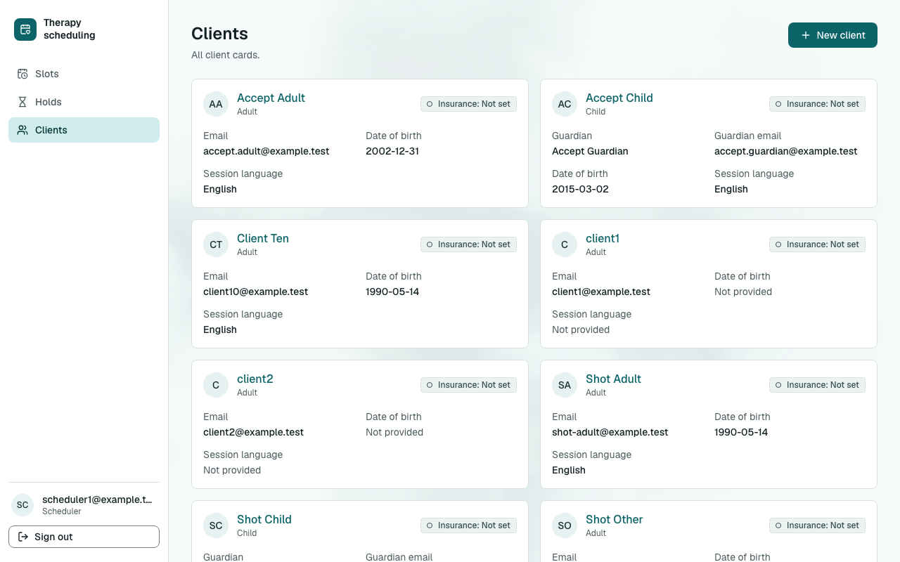
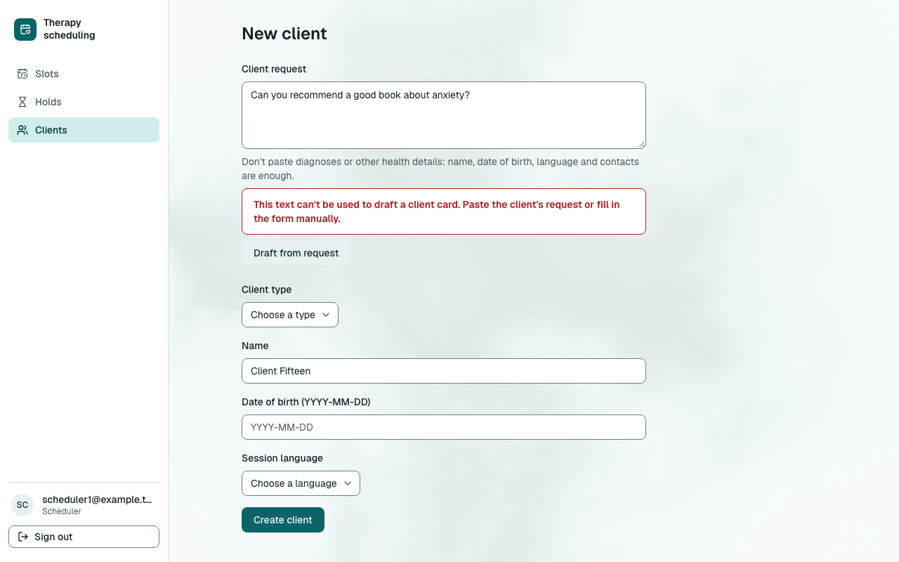

# Звіт UAT — 15.11.2026

- **Застосунок:** https://therapy-scheduling-weld.vercel.app (/api/health: коміт `53e90d6`)
- **Код тестів:** `task/intake-draft-uat` @ `ca42ff8` + незакомічені зміни
- **Прогін:** 15.11.2026, 13:56 (Київ), Playwright 27.5 с; AC: 2 — PASS 1, FAIL 0, NEEDS-HUMAN 1
- **Рецензент:** `claude-haiku-5-5`; суперечки → `claude-sonnet-5-5`. Разом за розбір: $0.0413 (ціни API; за підпискою — у межах ліміту плану)
- **Відео й траси:** не в git і не в CI — лише `test-results/` на машині прогону; трасу відкриває `npx playwright show-trace <trace.zip>`

> Примітка: «+ незакомічені зміни» у шапці — лише `.claude/launch.json` (локальна конфігурація dev-сервера, не код тестів); код тестів був закомічений (`ca42ff8`, потім без змін до здачі). Повторний прогін AC-INTAKE-03 із вільним іменем — `docs/qa/uat/2026-11-21-intake-draft/`.

| AC | Перевірки | Агент | Підсумок | Чому | Playwright | Розбір |
|---|---|---|---|---|---|---|
| AC-INTAKE-03 | пройшли | Haiku: NEEDS-HUMAN, Sonnet: NEEDS-HUMAN | **NEEDS-HUMAN** | R3: перевірки пройшли, агент не погоджується — вирішує людина | 8.4 с | $0.0393, 22.8 с |
| AC-INTAKE-06 | пройшли | Haiku: PASS | **PASS** | R6: перевірки, агент і цитати збігаються | 5.7 с | $0.0021, 9.2 с |

## AC-INTAKE-03 — NEEDS-HUMAN

**Тест:** AC-INTAKE-03: чернетку за текстом з AC-INTAKE-01 заповнено у формі, але картку не створено — у списку клієнтів «Client Ten» немає

**Критерій** (requirements/36-planuvalnyk-otrymuie-chernetku-kartky.md):

> AC-INTAKE-03: Дано чернетку за текстом з AC-INTAKE-01 заповнено у формі нової картки. Коли scheduler1 не створює картку й відкриває список клієнтів. Тоді картки «Client Ten» у списку немає: картку створює лише сам планувальник, коли зберігає форму.

**Кроки:** ✔ Дано: чернетку за текстом з AC-INTAKE-01 заповнено у формі нової картки → ✔ Коли: scheduler1 не створює картку й відкриває список клієнтів → ✔ Тоді: картки «Client Ten» у списку немає: картку створює лише сам планувальник, коли зберігає форму

**Агент (claude-sonnet-5-5, NEEDS-HUMAN):** На кадрі сторінка «Clients» з однією видимою карткою «Client Ten» (client10@example.test), але список обрізаний нижче «Shot Other». Решту карток не видно, тому відсутність дубліката підтвердити не можна, потрібна людина.

Haiku сказав NEEDS-HUMAN, тож розбір повторив Sonnet; рішення агента — за Sonnet.

**Агент бачить вади:**
- Кадр обрізаний знизу: видно лише 8 карток (остання, Shot Other, неповна), решта списку не видна, тож не можна підтвердити, що «Client Ten» рівно одна.

**Правило:** R3: перевірки пройшли, агент не погоджується — вирішує людина

**Відео:** `test-results/artifacts/intake-draft-AC-INTAKE-03--a9d11-клієнтів-«Client-Ten»-немає-chromium/video.webm` · **траса:** `test-results/artifacts/intake-draft-AC-INTAKE-03--a9d11-клієнтів-«Client-Ten»-немає-chromium/trace.zip` (не в git)

**Рішення PM:** ☐ приймаю · ☐ відхилення від вимог (issue «Відхилення від вимог: AC-INTAKE-03 — …») · @login: ____

## AC-INTAKE-06 — PASS

**Тест:** AC-INTAKE-06: текст не про нового клієнта — поля форми не змінено (Name лишається «Client Fifteen»), scheduler1 бачить повідомлення про відмову

**Критерій** (requirements/36-planuvalnyk-otrymuie-chernetku-kartky.md):

> AC-INTAKE-06: Дано у формі нової картки вже введено Name «Client Fifteen». Коли scheduler1 просить скласти чернетку з тексту звернення «Can you recommend a good book about anxiety?». Тоді поля форми не змінено (Name лишається «Client Fifteen»), і scheduler1 бачить повідомлення «This text can't be used to draft a client card. Paste the client's request or fill in the form manually.»

**Кроки:** ✔ Дано: у формі нової картки вже введено Name «Client Fifteen» → ✔ Коли: scheduler1 просить скласти чернетку з тексту звернення «Can you recommend a good book about anxiety?» → ✔ Тоді: поля форми не змінено (Name лишається «Client Fifteen»), і scheduler1 бачить повідомлення «This text can't be used to draft a client card. Paste the client's request or fill in the form manually.»

**Агент (claude-haiku-5-5, PASS):** На кадрі сторінка «New client»: поле Name містить «Client Fifteen», а під полем «Client request» з текстом «Can you recommend a good book about anxiety?» червоним показано повідомлення «This text can't be used to draft a client card. Paste the client's request or fill in the form manually.». Текст повідомлення збігається з критерієм; апострофи на кадрі виглядають прямими, як у критерії, але за такої роздільності typographic-апостроф повністю не виключити.

**Цитати агента, звірені зі сторінкою (aria):**
- «Client Fifteen» — є на сторінці
- «This text can't be used to draft a client card. Paste the client's request or fill in the form manually.» — є на сторінці

**Правило:** R6: перевірки, агент і цитати збігаються

**Відео:** `test-results/artifacts/intake-draft-AC-INTAKE-06--2322f-ть-повідомлення-про-відмову-chromium/video.webm` · **траса:** `test-results/artifacts/intake-draft-AC-INTAKE-06--2322f-ть-повідомлення-про-відмову-chromium/trace.zip` (не в git)

**Рішення PM:** ☐ приймаю · ☐ відхилення від вимог (issue «Відхилення від вимог: AC-INTAKE-06 — …») · @login: ____

## Як читати підсумок

- **PASS** — автоматичні перевірки пройшли, агент-рецензент погодився з кадром, а кожну його цитату знайдено на сторінці.
- **FAIL** — впала автоматична перевірка. Агент цього не перекриває: невидимі вади (буфер обміну, база) він на кадрі не побачить.
- **NEEDS-HUMAN** — перевірки зелені, але агент не погодився або його цитати немає на сторінці. Часто це слабкий тест або розбіжність між текстом AC і тестом — питання до PM, а не обов'язково вада продукту.

Правила: R1: перевірка впала — FAIL завжди, агент не перекриває; R2: немає вердикту агента (або він про інший AC) чи кадру; R3: перевірки пройшли, агент не погоджується — вирішує людина; R4: не всі видимі частини підтверджено або цитат агента немає на сторінці (aria); R5: помилка сторінки або 5xx під час сценарію; R6: перевірки, агент і цитати збігаються.
